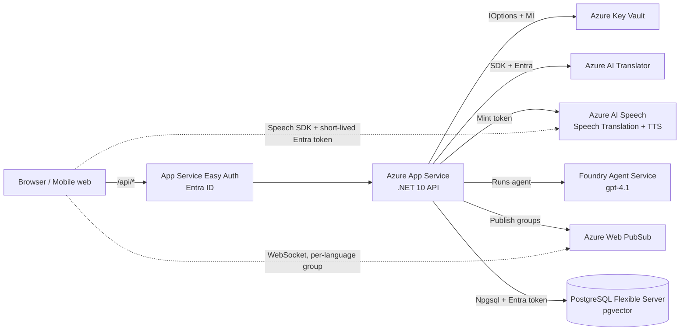

# AI Translator

Multilingual chat and on-site meeting translator hosted on Azure and powered by Microsoft Foundry, Azure AI Translator, and Azure AI Speech.

- **Personal chat** — pick a peer, type or dictate a message, it lands in the peer's language. Full history is stored per user; nobody sees anyone else's chats.
- **On-site meetings** — the initiator creates a meeting and gets a QR code and a shareable link. Guests scan/click, sign in, pick their language, and start receiving real-time translated speech in their own language via Web PubSub + Neural TTS. Each participant only sees their language stream.
- **Foundry agent** — Microsoft Foundry (`gpt-4.1`) is used only for meeting-summary generation and best-effort "who is being addressed" inference. Translation itself is done by Azure AI Translator (text) and Azure AI Speech Translation (voice) for lower latency and predictable cost.

Full design (schema, REST API, WPS protocol, JWT claims, sequence diagrams): [`docs/translator-design.md`](./docs/translator-design.md).

## Architecture



**Data isolation** — every repository query is scoped by the current `userId` from Easy Auth. Meetings are additionally scoped by participant membership; a listener only ever receives their preferred-language group over Web PubSub. Original meeting audio never leaves the browser.

**All-Entra, no keys** — Translator, Speech, Web PubSub, Postgres, and Key Vault all authenticate the App Service user-assigned managed identity. `disableLocalAuth: true` is set on every service that supports it, and Postgres has `passwordAuth: Disabled`.

## Repository layout

```
infra-as-code/bicep/     Azure resources (Foundry, Translator, Speech, Postgres,
                         Web PubSub, Key Vault, App Service + Easy Auth)
agents/                  Versioned Foundry agent JSON (translator-agent)
docs/translator-design.md  Detailed design contract
website/chatui/          .NET 10 API host (Auth, Data, Services, Controllers)
scripts/deploy-infra.sh  Bicep deploy wrapper
```

## Prerequisites

- An [Azure subscription](https://azure.microsoft.com/free/) with these resource providers registered: `Microsoft.CognitiveServices`, `Microsoft.Insights`, `Microsoft.ManagedIdentity`, `Microsoft.OperationalInsights`, `Microsoft.Storage`, `Microsoft.DBforPostgreSQL`, `Microsoft.SignalRService`, `Microsoft.KeyVault`.
- Sufficient quota in your chosen region:
  - Foundry / OpenAI: `gpt-4.1` deployment (50k TPM).
  - App Service Plan: B1 Linux (raise for load).
  - Postgres Flexible Server: `Standard_B1ms` Burstable.
  - Web PubSub: 1 unit Standard.
- Deployment user permissions at subscription scope:
  - `User Access Administrator` or `Owner` (to assign roles to the App Service managed identity).
  - `Cognitive Services Contributor` (to purge soft-deleted accounts during cleanup).
- Local tools: [Azure CLI](https://learn.microsoft.com/cli/azure/install-azure-cli), `.NET 10 SDK`, `dotnet-ef` global tool (`dotnet tool install --global dotnet-ef --version 10.0.1`), `psql` (for one-time DB bootstrap), `openssl` (for the join-token seed).

## Deploy

The workload has been tested in `swedencentral`. Other quota-available regions in the Foundry list (`eastus2`, `uksouth`, `westeurope`, `australiaeast`, ...) should also work.

### 1. Deploy infrastructure

```bash
git clone <this-repo>
cd ai-translator
az login
az account set --subscription <subId>

cp scripts/deploy-infra.env scripts/deploy-infra.local.env
# Edit deploy-infra.local.env to set BASE_NAME (6-8 lowercase chars, globally unique)
# and, optionally, ENTRA_APP_CLIENT_ID once the app registration exists.

bash scripts/deploy-infra.sh
```

The deployment takes 15–20 minutes. Watch for two output values at the end:
- `postDeployHintKeyVault` — an `az keyvault secret set` command to seed the join-token signing key.
- `postDeployHintPostgres` — a `psql` command to enable `pgvector` in the app database using your Entra token.

### 2. Bootstrap the data plane

Copy the printed commands and run them. Equivalents:

```bash
# 2a. Seed the meeting-join JWT signing key
az keyvault secret set \
  --vault-name kv-<basename> \
  --name join-token-signing-key \
  --value "$(openssl rand -base64 64)"

# 2b. Enable pgvector in the app database
PGPASSWORD=$(az account get-access-token --resource-type oss-rdbms --query accessToken -o tsv) \
  psql "host=pg-<basename>.postgres.database.azure.com dbname=translator user=<your-upn> sslmode=require" \
  -c "CREATE EXTENSION IF NOT EXISTS vector;"

# 2c. Apply EF Core migrations (same auth as above)
export ConnectionStrings__DefaultConnection="Host=pg-<basename>.postgres.database.azure.com;Database=translator;Username=<your-upn>;Password=$(az account get-access-token --resource-type oss-rdbms --query accessToken -o tsv);SSL Mode=Require"
dotnet ef database update --project website/chatui
```

### 3. Deploy the translator Foundry agent

Follow [`agents/README.md`](./agents/README.md). Copy the returned agent id + version onto the App Service:

```bash
az webapp config appsettings set -g <resource-group> -n app-<basename> \
  --settings AIAgentId=<agent-id> AIAgentVersion=<version>
```

### 4. Enable Easy Auth (optional but recommended)

Create an Entra app registration for the App Service:

1. In Portal → Entra ID → App registrations → New registration.
2. Redirect URI: Web → `https://app-<basename>.azurewebsites.net/.auth/login/aad/callback`.
3. Under **Expose an API**, set the Application ID URI to `api://<clientId>`.
4. Copy the client ID and put it into `deploy-infra.local.env` as `ENTRA_APP_CLIENT_ID`.
5. Re-run `scripts/deploy-infra.sh` — the second Bicep pass will wire `authsettingsV2` on the App Service so unauthenticated requests are redirected to Entra.

### 5. Deploy the API

```bash
cd website/chatui
dotnet publish -c Release -o ./publish
cd publish && zip -r ../chatui.zip . && cd ..
az webapp deploy -g <resource-group> -n app-<basename> --type zip --src-path chatui.zip
```

Browse `https://app-<basename>.azurewebsites.net/api/me` — after Easy Auth sign-in you should see your user profile as JSON, auto-provisioned in the `users` table.

## Local development

Local runs go against the deployed Azure services (no local Docker required).

1. `az login` — provides the Entra token used by `DefaultAzureCredential` for Postgres, Translator, Speech, Web PubSub, and Key Vault access.
2. Create `website/chatui/appsettings.Development.json` with resource endpoints for your deployed environment and, optionally, a `DevAuth` block so requests without an Easy Auth header impersonate a fixed user:

   ```jsonc
   {
     "AIProjectEndpoint": "https://aif<basename>.services.ai.azure.com/api/projects/projchat",
     "AIAgentId": "<translator-agent-id>",
     "AIAgentVersion": "<version>",
     "Translator": { "Endpoint": "https://trans<basename>.cognitiveservices.azure.com/", "Region": "swedencentral" },
     "Speech": { "Endpoint": "https://swedencentral.api.cognitive.microsoft.com/", "Region": "swedencentral", "ResourceId": "/subscriptions/…/providers/Microsoft.CognitiveServices/accounts/speech<basename>" },
     "WebPubSub": { "Endpoint": "https://wps-<basename>.webpubsub.azure.com", "Hub": "meetings", "ClientTokenLifetimeMinutes": 60 },
     "KeyVault": { "Uri": "https://kv-<basename>.vault.azure.net/", "JoinTokenSigningKeySecretName": "join-token-signing-key" },
     "JoinToken": { "Audience": "meeting-join", "LifetimeHours": 24 },
     "Postgres": { "Host": "pg-<basename>.postgres.database.azure.com", "Database": "translator", "Username": "<your-upn>" },
     "DevAuth": { "Enabled": true, "EntraObjectId": "00000000-0000-0000-0000-000000000001", "DisplayName": "Local Dev", "Email": "dev@local", "PreferredLanguage": "en" }
   }
   ```

3. `cd website/chatui && dotnet run` — the API listens on `http://localhost:5000` (or the port shown in the console). `curl http://localhost:5000/api/me` returns the dev user.

`DevAuth` is silently ignored outside the `Development` environment.

## Clean up

```bash
az group delete -n <resource-group> -y

# Purge soft-deleted Cognitive Services and Key Vault so the same base name can be reused
az cognitiveservices account purge -g <resource-group> -l <location> -n aif<basename>
az cognitiveservices account purge -g <resource-group> -l <location> -n trans<basename>
az cognitiveservices account purge -g <resource-group> -l <location> -n speech<basename>
az keyvault purge -n kv-<basename> -l <location>
```

Postgres and Web PubSub delete synchronously with the resource group and do not need purging.

## Contributing

See [`CONTRIBUTING.md`](./CONTRIBUTING.md). This project has adopted the [Microsoft Open Source Code of Conduct](https://opensource.microsoft.com/codeofconduct/); see the [Code of Conduct FAQ](https://opensource.microsoft.com/codeofconduct/faq/) or contact <opencode@microsoft.com> with questions.
