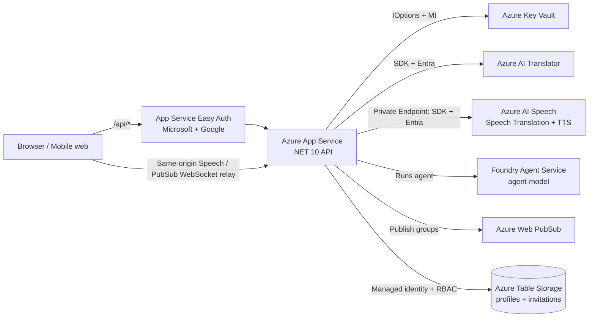

# AI Translator

Multilingual chat and on-site meeting translator hosted on Azure and powered by Microsoft Foundry, Azure AI Translator, and Azure AI Speech.

- **Personal chat** — pick a peer, type or dictate a message, and receive a translation in the peer's language. Conversation state is transient; only invited user profiles and language preferences are persisted.
- **On-site meetings** — the initiator creates a meeting and gets a QR code and a shareable link. Guests scan/click, sign in, pick their language, and start receiving real-time translated speech in their own language via Web PubSub + Neural TTS. Each participant only sees their language stream.
- **Foundry agent** — Microsoft Foundry (`agent-model`, currently `gpt-5.4-mini`) is used for meeting-summary generation and best-effort "who is being addressed" inference. Translation itself is done by Azure AI Translator (text) and Azure AI Speech Translation (voice). Training uses the separate realtime model.

Full design (schema, REST API, WPS protocol, JWT claims, sequence diagrams): [`docs/translator-design.md`](./docs/translator-design.md).

## Architecture



**Identity isolation** — users are identified by provider plus the provider's stable subject claim. Microsoft and Google profiles are never merged automatically by email. An authenticated user needs an active profile or an explicit unclaimed invitation.

**Managed identity for Azure data** — Translator, Speech, Web PubSub, Table Storage, and Key Vault authenticate the App Service user-assigned managed identity. Shared storage keys and connection strings are disabled. OAuth client secrets remain in Key Vault and are exposed only as App Service Key Vault references.

## Repository layout

```
infra-as-code/bicep/     Azure resources (Foundry, Translator, Speech, Table Storage,
                         Web PubSub, Key Vault, App Service + Easy Auth)
agents/                  Versioned Foundry agent JSON (translator-agent)
docs/translator-design.md  Detailed design contract
website/chatui/          .NET 10 API host (Auth, Data, Services, Controllers)
scripts/deploy-infra.sh  Bicep deploy wrapper
```

## Prerequisites

- An [Azure subscription](https://azure.microsoft.com/free/) with these resource providers registered: `Microsoft.CognitiveServices`, `Microsoft.Insights`, `Microsoft.ManagedIdentity`, `Microsoft.OperationalInsights`, `Microsoft.Storage`, `Microsoft.SignalRService`, `Microsoft.KeyVault`. `Microsoft.DBforPostgreSQL` is needed only while migrating an existing deployment.
- Sufficient quota in your chosen region:
  - Foundry / OpenAI: `gpt-5.4-mini` reasoning deployment (50k TPM), `gpt-realtime-translate` for Start talking, plus `gpt-realtime-2.1` and `gpt-live-transcribe` for Training and input transcription.
  - App Service Plan: B1 Linux (raise for load).
  - Storage account: Standard LRS. PostgreSQL `Standard_B1ms` remains only during migration.
  - Web PubSub: 1 unit Standard.
- Deployment user permissions at subscription scope:
  - `User Access Administrator` or `Owner` (to assign roles to the App Service managed identity).
  - `Cognitive Services Contributor` (to purge soft-deleted accounts during cleanup).
- Local tools: [Azure CLI](https://learn.microsoft.com/cli/azure/install-azure-cli), `.NET 10 SDK`, `dotnet-ef` global tool (`dotnet tool install --global dotnet-ef --version 10.0.1`), `psql` (for one-time DB bootstrap), `openssl` (for the join-token seed).

## Deploy

### Private Networking

Only App Service accepts public application traffic. Its VNet integration reaches Foundry,
Speech, Translator, Key Vault, Table Storage, Web PubSub, and Azure Monitor through Private
Endpoints and linked private DNS zones. Public ingestion and queries are disabled for
Application Insights and Log Analytics. Bing Grounding is not provisioned.

Browser Speech and PubSub connections use `/api/relay/*` on the application origin.
Speech credentials stay on the server; PubSub retains its issued per-user group permissions.
Administrative SCM access uses Entra authentication, not publishing passwords.

The Bicep deployment creates the profile and invitation tables and grants the App Service managed identity `Storage Table Data Contributor`. Existing PostgreSQL deployments must run the one-time migration and compare source/destination counts before setting `RETAIN_POSTGRES=false`. Use protected temporary input outside web root for migration credentials, never log tokens or personal data, and remove temporary artifacts after verification.

Set `aiAgentName` and `aiAgentVersion` to the bootstrapped agent version when redeploying IaC.
`TrainingMemberObjectIds` controls access to both Free and Guided Practice. Guided Practice is
enabled by `TrainingGuidedEnabled`. The optional `--verify-services` command must run in the app container with its managed
identity, not SCM. Never leave the diagnostic startup script configured for normal operation.

Free Practice treats Start through Stop as one recording, including pauses. Stop commits the
entire recording for one English translation or correction and spoken response. The original
transcript appears after Stop in one message; playback finishes before the next recording.

The September 2026 private deployment passed runtime managed-identity checks for PostgreSQL,
Translator, Key Vault, Speech synthesis, Web PubSub, Foundry summarisation, and the Training
realtime connection. Speech SDK 1.51.2 is required by this verified build; 1.43.0 failed in the
current Linux App Service image even though the same endpoint worked through .NET WebSocket.
The operator confirmed browser sign-in and microphone capture on September 10, 2026; Guided
Practice was then enabled for the existing Training members. A complete Guided exercise still
requires live acceptance testing. This first slice is session-only: persistent progress,
spaced review, and daily workouts are not implemented yet.

Rotate Microsoft and Google OAuth credentials before expiry. Update the configured Key Vault secrets, refresh the App Service Key Vault references, verify both provider sign-ins, and only then remove previous credentials.


The workload has been tested in `swedencentral`. Other quota-available regions in the Foundry list (`eastus2`, `uksouth`, `westeurope`, `australiaeast`, ...) should also work.

### 1. Deploy infrastructure

```bash
git clone <this-repo>
cd ai-translator
az login
az account set --subscription <subId>

cp scripts/deploy-infra.env scripts/deploy-infra.local.env
# Set BASE_NAME, MICROSOFT_CLIENT_ID, GOOGLE_CLIENT_ID, and the Key Vault
# secret names. Keep RETAIN_POSTGRES=true until migration verification passes.

bash scripts/deploy-infra.sh
```

The deployment takes 15–20 minutes. `postDeployHintKeyVault` shows how to seed the meeting join-token key. `postDeployHintPostgres` reports whether the temporary migration source is retained.

### 2. Bootstrap the data plane

Seed the meeting-join signing key and both OAuth client secrets in Key Vault. Use the secret names configured in `deploy-infra.local.env`.

```bash
az keyvault secret set --vault-name kv-<basename> \
  --name join-token-signing-key --value "$(openssl rand -base64 64)"
az keyvault secret set --vault-name kv-<basename> \
  --name microsoft-login-client-secret --value '<microsoft-client-secret>'
az keyvault secret set --vault-name kv-<basename> \
  --name google-login-client-secret --value '<google-client-secret>'
```

Do not put OAuth secrets, storage keys, or connection strings in source control.

### 3. Deploy the translator Foundry agent

Follow [`agents/README.md`](./agents/README.md). Copy the returned agent id + version onto the App Service:

```bash
az webapp config appsettings set -g <resource-group> -n app-<basename> \
  --settings AIAgentId=<agent-id> AIAgentVersion=<version>
```

### 4. Configure Microsoft and Google sign-in

1. Create a Microsoft identity app registration that supports organizational directories and personal Microsoft accounts. Add `https://app-<basename>.azurewebsites.net/.auth/login/aad/callback` as a web redirect URI and set `api://<clientId>` as the Application ID URI.
2. Create a Google OAuth web client and add `https://app-<basename>.azurewebsites.net/.auth/login/google/callback` as an authorized redirect URI.
3. Put both client IDs and Key Vault secret names in `deploy-infra.local.env`, seed the secrets as shown above, and rerun `scripts/deploy-infra.sh`.
4. Create invitations before users sign in. Authentication alone does not provision public access; Microsoft and Google profiles remain separate even when their email addresses match.

The app's login page stays public so users can choose a provider. Protected API and WebSocket routes enforce authentication and invite-only authorization in the application.

### 5. Deploy the API

```bash
cd website/chatui
dotnet publish -c Release -o ./publish
cd publish && zip -r ../chatui.zip . && cd ..
az webapp deploy -g <resource-group> -n app-<basename> --type zip --src-path chatui.zip
```

Browse `https://app-<basename>.azurewebsites.net/`, choose Microsoft or Google, and verify `/api/me` returns the invited profile from the `users` table.

## Local development

Local runs go against the deployed Azure services (no local Docker required).

1. `az login` — provides the Entra token used by `DefaultAzureCredential` for Table Storage, Translator, Speech, Web PubSub, and Key Vault access.
2. Create `website/chatui/appsettings.Development.json` with resource endpoints for your deployed environment and, optionally, enable `DevAuth` so requests can select an invited development persona:

   ```jsonc
   {
     "AIProjectEndpoint": "https://aif<basename>.services.ai.azure.com/api/projects/projchat",
     "AIAgentId": "<translator-agent-id>",
     "AIAgentVersion": "<version>",
     "Translator": { "Endpoint": "https://trans<basename>.cognitiveservices.azure.com/", "Region": "swedencentral" },
     "Speech": { "Endpoint": "https://swedencentral.api.cognitive.microsoft.com/", "Region": "swedencentral", "ResourceId": "/subscriptions/…/providers/Microsoft.CognitiveServices/accounts/speech<basename>" },
     "WebPubSub": { "Endpoint": "https://wps-<basename>.webpubsub.azure.com", "Hub": "meetings", "ClientTokenLifetimeMinutes": 60 },
     "KeyVault": { "Uri": "https://kv-<basename>.vault.azure.net/", "JoinTokenSigningKeySecretName": "join-token-signing-key" },
     "JoinToken": { "Audience": "meeting-join", "LifetimeHours": 24 },
     "TableStorage": { "Endpoint": "https://st<basename>.table.core.windows.net", "UsersTableName": "users", "UserInvitesTableName": "userinvites" },
     "DevAuth": { "Enabled": true }
   }
   ```

3. Create an invitation with `tools/UserProfileAdmin` (below), then run `cd website/chatui && dotnet run`. Open `/?dev=<persona>` or send the `X-Dev-Oid`, `X-Dev-Name`, `X-Dev-Email`, and `X-Dev-Lang` headers. The email must match the invitation.

`DevAuth` is silently ignored outside the `Development` environment.

## User migration and invitations

The administration tool uses `DefaultAzureCredential` and never accepts storage keys or PostgreSQL connection strings. Because both data services are private, run it from a VNet-connected execution environment whose managed identity has PostgreSQL access and `Storage Table Data Contributor` (the App Service identity already receives these permissions during the retained migration phase).

```bash
# Idempotently migrate existing Entra profiles. Keep PostgreSQL until verified=true.
dotnet run --project tools/UserProfileAdmin -- migrate \
  --table-endpoint https://st<basename>.table.core.windows.net \
  --postgres-host pg-<basename>.postgres.database.azure.com \
  --postgres-database translator \
  --postgres-user <your-upn>

# Invite one account for either provider (use microsoft or google to restrict it).
dotnet run --project tools/UserProfileAdmin -- invite \
  --table-endpoint https://st<basename>.table.core.windows.net \
  --email user@example.com --provider any
```

Migration output contains counts only. Do not set `RETAIN_POSTGRES=false` unless `failed=0`, `verified=true`, and both provider sign-in paths have been tested.

## Clean up

```bash
az group delete -n <resource-group> -y

# Purge soft-deleted Cognitive Services and Key Vault so the same base name can be reused
az cognitiveservices account purge -g <resource-group> -l <location> -n aif<basename>
az cognitiveservices account purge -g <resource-group> -l <location> -n trans<basename>
az cognitiveservices account purge -g <resource-group> -l <location> -n speech<basename>
az keyvault purge -n kv-<basename> -l <location>
```

Storage, any retained PostgreSQL migration source, and Web PubSub delete with the resource group and do not need purging.

## Contributing

See [`CONTRIBUTING.md`](./CONTRIBUTING.md). This project has adopted the [Microsoft Open Source Code of Conduct](https://opensource.microsoft.com/codeofconduct/); see the [Code of Conduct FAQ](https://opensource.microsoft.com/codeofconduct/faq/) or contact <opencode@microsoft.com> with questions.
