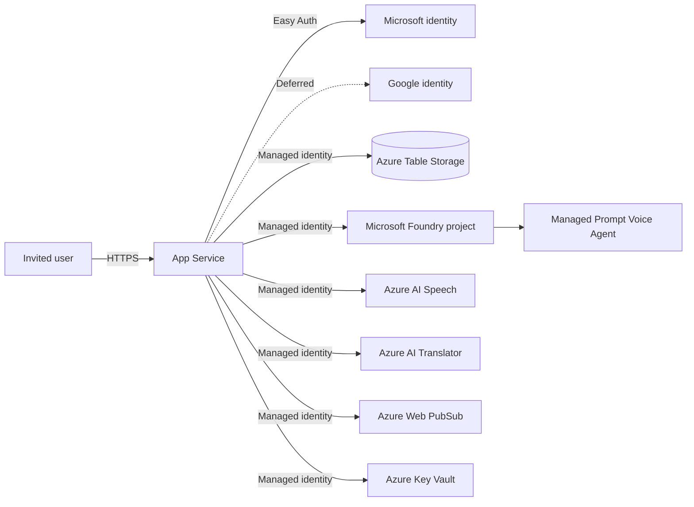
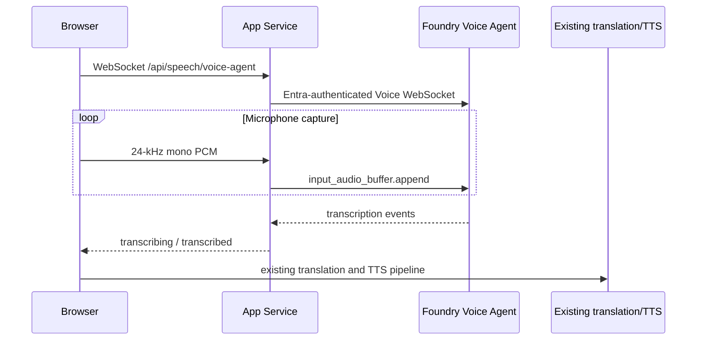

# AI Translator Production Implementation

> **Target:** tenant `871d492f-64dd-4e37-9958-f6c19fb0118d`, subscription `164328f9-1cf3-4f78-8cd0-728122021b45`, Sweden Central

## Architecture

The production deployment uses public HTTPS service endpoints without private endpoints or App Service VNet integration. Public reachability does not grant data access: application-to-service calls use the App Service user-assigned managed identity, least-privilege RBAC, and Entra tokens. Storage shared-key access and supported local AI authentication are disabled.

## Resource layout

| Resource | Name | Purpose |
| --- | --- | --- |
| Resource group | `rg-aitr-prod-swe-001` | Production boundary |
| Foundry account | `ai-aitr-prod-swe-001` | Agent and model runtime |
| Foundry project | `projchat` | Chat and Voice Agents |
| App Service | `app-aitr-prod-swe-001` | Browser UI and API |
| Storage account | `staitrprodswe001` | Profiles and invitations |
| Key Vault | `kv-aitr-prod-swe-001` | OAuth and meeting secrets |
| Voice Agent | `agent-aitr-prod-swe-001` | Managed speech transcription path |

## Authentication and authorization

App Service Authentication v2 exposes provider-specific Microsoft and Google login endpoints. Microsoft organizational and personal accounts are enabled first; Google remains disabled until an operator supplies its OAuth client ID and secret securely. The Microsoft app registration must enable web ID-token issuance because Easy Auth uses the hybrid `code id_token` authorization flow.

The application normalizes each authenticated principal as provider, issuer, and stable subject. It performs invite-only authorization against Table Storage and never merges profiles by email. Email is used only to claim an explicit operator-created invitation. Protected HTTP and WebSocket routes enforce authorization in the application so the public login selector can load anonymously.

## Table Storage migration

Profiles use the provider as `PartitionKey` and a deterministic issuer/subject key as `RowKey`. Invitations use provider or `any` plus a deterministic normalized-email key. Azure SDK clients use `DefaultAzureCredential`; Azure selects the configured user-assigned managed identity.

The migration command is idempotent and preserves existing application GUIDs. PostgreSQL is retained only when importing an existing deployment. The new production tenant does not require a PostgreSQL server.

## Managed Voice flow

The Voice Agent definition is stored in `azure.yaml` as `translator-voice`, `kind: voice`, with `gpt-realtime`, Azure Speech transcription, server VAD, 24-kHz PCM, and `createResponse: false`. The adapter ignores generated response audio/transcripts so they cannot be mistaken for user speech. `s2s-realtime` remains the default and immediate rollback mode.

## Configuration

The web application receives:

- `ChatApi__FoundryVoiceEnabled=true`
- `ChatApi__FoundryVoiceAgentName=agent-aitr-prod-swe-001`
- the Foundry project endpoint from the deployed project
- Table Storage endpoint and table names
- Key Vault references for provider secrets
- `AZURE_CLIENT_ID` for the user-assigned managed identity

No service keys, connection strings, provider secrets, or fixed storage credentials are committed.

## Validation and release

Before deployment:

1. Run the .NET and Node test suites and a Release publish.
2. Format and compile all changed Bicep entry points.
3. Run `azd ai agent doctor` for the `prod` environment with the required process-local Foundry flags.
4. Run Azure validation and resource-group what-if with `enablePrivateNetworking=false`, `retainPostgres=false`, and AI Gateway disabled.
5. Confirm what-if contains no PostgreSQL, private endpoint, VNet integration, NAT Gateway, API Management, or ACR resources.

After deployment, verify invited Microsoft login, uninvited rejection, profile persistence, microphone capture, chat translation, meeting fan-out, managed Voice transcription, and the `s2s-realtime` rollback path. Google verification is deferred until credentials are available.
