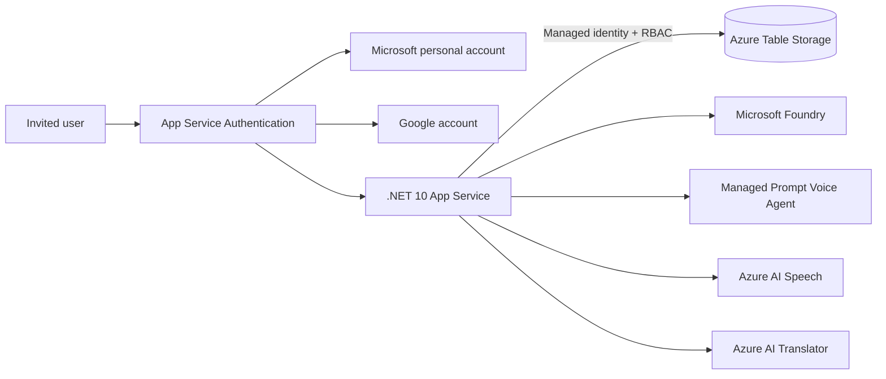

# AI Translator Production Modernization — Specification

> **Last updated:** 2026-11-20

## 1. Summary

Replace the application's tenant-only Microsoft Entra workforce sign-in with direct Azure App Service authentication for Microsoft personal/Hotmail and Google/Gmail accounts, while preserving invite-only access. Replace Azure Database for PostgreSQL user-profile persistence with Azure Table Storage accessed through the App Service user-assigned managed identity.

Deploy a new production instance in tenant `871d492f-64dd-4e37-9958-f6c19fb0118d`, subscription `164328f9-1cf3-4f78-8cd0-728122021b45`, and Sweden Central. Introduce a managed Microsoft Foundry Prompt Voice Agent as an optional browser recognition path while retaining the existing GPT Realtime speech-to-speech and transcription controllers for rollback.

## 2. Goals & Non-Goals

**Goals**
- Allow invited users to sign in with Microsoft personal or Google identities.
- Keep identities from different providers as separate user profiles.
- Preserve invite-only authorization after successful authentication.
- Store user profiles and invitations in Azure Table Storage without account keys.
- Migrate existing PostgreSQL users before removing PostgreSQL resources and dependencies.
- Preserve current `/api/me`, `/api/users`, chat, training, and meeting behavior.
- Reduce recurring database cost and operational complexity.
- Provision a production workload in Sweden Central using the approved lowercase naming convention.
- Use public service endpoints protected by TLS, Entra tokens, managed identities, least-privilege RBAC, and disabled local/shared-key authentication.
- Add managed Prompt Voice transcription at 24 kHz without removing the current speech-to-speech path.

**Non-Goals**
- Automatic account linking by email.
- Public self-registration.
- Persisting transient conversations, messages, meetings, or training sessions.
- Replacing App Service hosting, Foundry, Speech, Translator, Web PubSub, or Key Vault.
- Creating Google OAuth credentials automatically; an operator supplies the Google client ID and secret.
- Replacing the browser UI, App Service host, meeting fan-out, or invite authorization with a Foundry Agent.
- Provisioning PostgreSQL, private endpoints, VNet integration, NAT Gateway, API Management, ACR, or a Hosted Agent in the new production tenant.

## 3. Users & Scenarios

| Persona | Scenario | Success Criteria |
| --- | --- | --- |
| Invited Microsoft user | Signs in using a personal Microsoft/Hotmail account | App Service authenticates the user and the application loads the matching active profile. |
| Invited Google user | Signs in using a Google/Gmail account | App Service authenticates the user and the application loads the matching active profile. |
| Uninvited user | Completes provider authentication | Application returns the existing not-provisioned response and does not create a profile. |
| Operator | Migrates existing users | Every PostgreSQL user is represented in Table Storage before PostgreSQL removal. |
| User | Changes preferred language | The updated language persists in Table Storage. |

## 4. Functional Requirements

| ID | Requirement | Priority |
| --- | --- | --- |
| FR-001 | The system MUST support direct App Service Microsoft and Google identity providers. | Must |
| FR-002 | The system MUST identify a principal by provider/issuer plus the provider's stable subject identifier, never by email alone. | Must |
| FR-003 | The system MUST keep Microsoft and Google identities as separate profiles unless explicitly provisioned otherwise. | Must |
| FR-004 | The system MUST reject authenticated identities without an active profile or matching unclaimed invitation. | Must |
| FR-005 | The system MUST store user profiles and invitations in Azure Table Storage. | Must |
| FR-006 | The application MUST access Table Storage through `TokenCredential` and managed identity in Azure. | Must |
| FR-007 | Existing API response shapes and user GUIDs MUST remain stable after migration. | Must |
| FR-008 | A one-time migration command MUST copy PostgreSQL users to Table Storage idempotently and report counts without logging personal data or tokens. | Must |
| FR-009 | PostgreSQL infrastructure and runtime dependencies MUST only be removed after the migration command and verification path exist. | Must |
| FR-010 | The application MUST expose provider-specific sign-in choices and preserve sign-out behavior. | Must |
| FR-011 | Training authorization MUST continue to support existing migrated Microsoft identities. | Must |

## 5. Non-Functional Requirements

| Category | Requirement |
| --- | --- |
| Security | Google secrets remain in Key Vault; storage keys and connection strings are prohibited; App Service MI receives only Storage Table Data Contributor. |
| Privacy | Do not log email addresses, provider subjects, OAuth tokens, migration input, or secrets. |
| Availability | LRS Table Storage is acceptable for this invite-only production workload; application behavior remains compatible with multiple App Service instances. |
| Performance | Profile lookup by provider and subject should require one point lookup; the small invite-only directory may use bounded scans. |
| Compatibility | Existing user GUIDs and API contracts remain unchanged. |
| Observability | Authentication rejection, migration counts, and Table Storage failures are logged without personal data. |

## 6. Architecture Overview

App Service authenticates each provider and forwards claims to the application. The application normalizes the provider and stable subject, performs a point lookup in Table Storage, and rejects identities that have not been provisioned. Provider choice is rendered by the application because App Service cannot automatically redirect unauthenticated users to two providers simultaneously.

## 7. Tech Stack

| Layer | Choice | Rationale |
| --- | --- | --- |
| Backend/frontend host | ASP.NET Core .NET 10 App Service | Preserve current application. |
| Authentication | App Service Authentication v2, Microsoft + Google | Direct provider support requested. |
| Data | Azure Table Storage via `Azure.Data.Tables` | Low-cost profile/invitation persistence and managed-identity support. |
| IaC | Existing Bicep modules | Surgical migration of deployed architecture. |
| AI | Existing Microsoft Foundry and Azure AI services | Unchanged. |

## 8. Azure Services

| Service | Purpose | SKU/Tier | Notes |
| --- | --- | --- | --- |
| App Service | UI/API and Easy Auth | Linux B1 | Public HTTPS endpoint; Microsoft provider enabled initially and Google deferred. |
| Storage Account | User profiles and invitations | Standard LRS / StorageV2 | Public service endpoint, shared-key access disabled, managed identity and Table RBAC only. |
| Key Vault | OAuth client secrets | Standard | Public endpoint, RBAC authorization, no public secret values in configuration. |
| Microsoft Foundry | Chat and managed Voice runtime | Standard | New account and `projchat` project; managed identity access. |
| Speech / Translator | Speech and translation | S0 | Public endpoints authenticated with Entra tokens; local/key authentication disabled. |
| Web PubSub | Meeting fan-out | Free/Standard per validated capacity | Managed-identity data-plane access. |

PostgreSQL is not provisioned in the new tenant. Migration tooling remains available only when importing profiles from an existing deployment.

## 9. AI / Foundry

- The existing chat agent remains configured by `AIAgentId` and `AIAgentVersion`.
- The optional managed Prompt Voice Agent is `agent-aitr-prod-swe-001` and uses `gpt-realtime`.
- Browser audio is mono 24-kHz PCM. The server bridges audio to the Voice Agent and maps transcription events into the existing browser protocol.
- `createResponse: false` prevents automatic model responses during microphone capture. Existing translation and TTS remain responsible for output.
- `s2s-realtime` remains the default rollback path.

## 10. Data Model

### `users` table
- `PartitionKey`: normalized provider (`microsoft`, `google`).
- `RowKey`: URL-safe encoding or deterministic hash of issuer plus stable provider subject.
- `Id`: existing application GUID.
- `Subject`: provider subject identifier.
- `Issuer`: normalized issuer.
- `DisplayName`, `Email`, `PreferredLanguage`.
- `CreatedAt`, `UpdatedAt`.

### `userinvites` table
- `PartitionKey`: normalized provider or `any`.
- `RowKey`: deterministic hash of normalized invited email.
- `Email`, `CreatedAt`, optional `ExpiresAt`, `ClaimedAt`, `ClaimedUserId`.

Email matching is permitted only for claiming an operator-created invitation after the configured provider has authenticated the email. Profiles are never automatically merged by email.

## 11. Interfaces

- Existing `/api/me` and `/api/users` contracts remain unchanged.
- Provider sign-in endpoints are `/.auth/login/aad` and `/.auth/login/google`.
- Add a one-time operator command for PostgreSQL-to-Table migration using a protected JSON input file and short-lived PostgreSQL administrator token, following the existing initialization-command pattern.
- Add an operator command or protected input format for creating invitations without storage account keys.

## 12. Resolved Decisions

| # | Decision | Resolution |
| --- | --- | --- |
| 1 | Identity architecture | Direct App Service Microsoft + Google providers. |
| 2 | Registration | Invite-only. |
| 3 | Account linking | Separate provider profiles. |
| 4 | PostgreSQL removal | Migrate existing users, verify, then remove PostgreSQL. |
