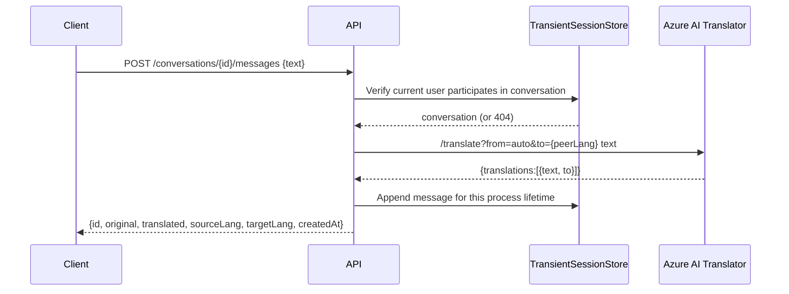
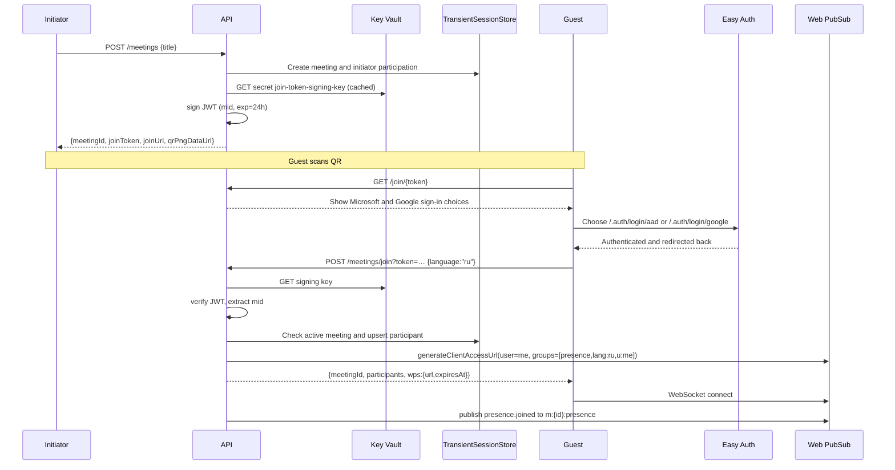
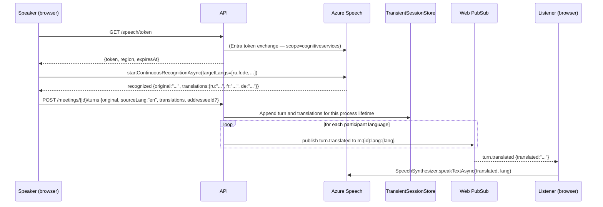
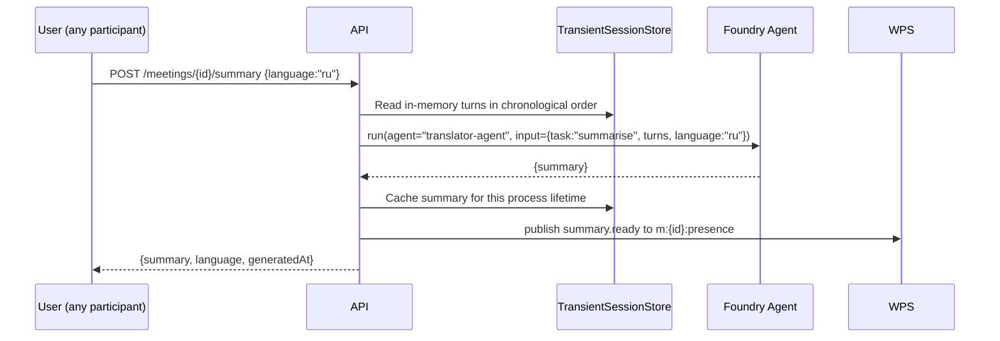

# AI Translator — Design

Status: **IMPLEMENTED DESIGN**
Owner: Sergey
Last updated: 2026-11-19

Companion documents:
- `README.md` — deployment and operations guide.
- `spec.md` — consumer identity and Table Storage requirements.
- `../infra-as-code/bicep/` — Bicep modules for Foundry, Translator, Speech, Table Storage, Web PubSub, Key Vault, and App Service.

This document specifies **only the workload-specific contract**: database schema, REST API, Web PubSub protocol, join-token structure, and the end-to-end flows. Infra decisions are documented inline in each `*.bicep` module.

---

## 1. Recap of architectural decisions

| Concern | Decision |
|---|---|
| Auth | App Service Easy Auth v2 with direct Microsoft (organizational + personal) and Google providers. Application authorization remains invite-only. |
| Data store | Azure Table Storage for user profiles and invitations, accessed through managed identity. Conversations, meetings, and training state remain transient. |
| Real-time | Azure Web PubSub, WebSocket fan-out per language group. |
| Personal-chat translation | Azure AI Translator (text). |
| Meeting translation | Azure AI Speech Translation on the client (STT + MT multi-target). Neural TTS on the client. |
| Reasoning tasks | Foundry Agent (GPT-4.1) for addressee-hint and meeting summarization only. |
| Audio | Never persisted. |
| Meeting join | Initiator gets QR + shareable URL. Join enforces sign-in and preferred-language selection. |
| Data isolation | Identity is keyed by normalized provider plus stable subject. Microsoft and Google profiles remain separate; invitations are claimed only after provider authentication. |

---

## 2. Persistent data model

The application persists only provider-aware user profiles and explicit invitations in Azure Table Storage. No account keys or connection strings are used.

### `users`

| Field | Purpose |
|---|---|
| `PartitionKey` | Normalized provider: `microsoft` or `google`. |
| `RowKey` | Deterministic URL-safe key derived from issuer plus stable provider subject. |
| `Id` | Stable application user GUID; preserved during migration. |
| `Subject` | Provider stable subject (`oid` with `sub` fallback for Microsoft, `sub` for Google). |
| `Issuer` | Normalized identity issuer. |
| `DisplayName`, `Email` | Profile metadata; never used to merge profiles. |
| `PreferredLanguage` | User language preference. |
| `CreatedAt`, `UpdatedAt` | UTC audit timestamps. |

### `userinvites`

| Field | Purpose |
|---|---|
| `PartitionKey` | Required provider or `any`. |
| `RowKey` | Deterministic hash of normalized invited email. |
| `Email` | Address asserted by the authenticated provider and matched to the invitation. |
| `CreatedAt`, `ExpiresAt` | Invitation lifetime. |
| `ClaimedAt`, `ClaimedUserId` | Atomic claim result. |

A profile point lookup uses provider plus subject. Email is considered only when claiming an operator-created invitation and never links Microsoft and Google profiles. PostgreSQL is a temporary migration source only: migrate idempotently, compare source and destination counts, test both providers, validate rollback, and then disable its Bicep module with `retainPostgres=false`.

Conversation, meeting, message, turn, and training state use the in-memory `TransientSessionStore`; they are intentionally not persisted by this migration. Audio is never persisted.

---

## 3. REST API

Base: `/api`. Protected endpoints require an authenticated Microsoft or Google Easy Auth principal and an active profile or claimable invitation. Responses are JSON. Errors use RFC 7807 `application/problem+json`.

### 3.1 Me

| Method | Path | Body | Returns |
|---|---|---|---|
| GET | `/api/me` | — | `{id, displayName, email, preferredLanguage}` — loaded by provider + stable subject; a matching invitation may be claimed on first authenticated call |
| PATCH | `/api/me` | `{preferredLanguage}` | updated me |
| GET | `/api/users?query=` | — | `[{id, displayName, email, preferredLanguage}]` — bounded search over active invited profiles |

### 3.2 Personal chat

| Method | Path | Body | Returns |
|---|---|---|---|
| GET | `/api/conversations` | — | `[{id, peer, lastMessageAt}]` — only conversations I participate in |
| POST | `/api/conversations` | `{peerId}` | `{id, peer}` — idempotent (finds existing) |
| GET | `/api/conversations/{id}/messages?before=<iso>&limit=50` | — | paged messages — 404 if I'm not a participant |
| POST | `/api/conversations/{id}/messages` | `{text, targetLanguage?}` | `{id, original, translated, sourceLang, targetLang, createdAt}` — `sourceLang` autodetected via Translator |

### 3.3 Meetings

| Method | Path | Body | Returns |
|---|---|---|---|
| GET | `/api/meetings/mine` | — | `[{id, title, status, role, createdAt}]` — meetings where I'm initiator or participant |
| POST | `/api/meetings` | `{title?}` | `{meetingId, joinToken, joinUrl, qrPngDataUrl}` — initiator only, called by the "Start on-site meeting" button |
| GET | `/api/meetings/{id}` | — | `{id, title, status, initiator, participants:[{userId,name,language,role}]}` — must be participant |
| POST | `/api/meetings/{id}/end` | — | 204 — initiator only, marks `status='ended'` and publishes `meeting.ended` on presence group |
| POST | `/api/meetings/join?token=<jwt>` | `{language}` | `{meetingId, participants, wps:{url, expiresAt}}` — validates JWT, upserts participant, returns WPS client access URL scoped to this user's groups |
| POST | `/api/meetings/{id}/leave` | — | 204 — sets `left_at`, publishes `presence.left` |
| GET | `/api/meetings/{id}/turns?before=<iso>&limit=100&lang=<code>` | — | paged turns, translations in `lang` (default = my preferred) — participant only |
| POST | `/api/meetings/{id}/turns` | `{original, sourceLang, translations:{lang:text,…}, addresseeId?}` | `{turnId, createdAt}` — persist and fan out. Speaker-only (verified via Easy Auth = participant with `role != 'listener'` or Entra id = speaker) |
| POST | `/api/meetings/{id}/summary` | `{language?}` | `{summary, language, generatedAt}` — calls Foundry agent, caches per language |
| GET | `/api/meetings/{id}/summary?lang=<code>` | — | cached summary if any |

### 3.4 Speech

| Method | Path | Body | Returns |
|---|---|---|---|
| GET | `/api/speech/token` | — | `{token, region, expiresAt}` — 10-minute Entra bearer scoped to `https://cognitiveservices.azure.com`, region = Speech account region. Consumed by the browser Speech SDK. |

### 3.5 Foundry addressee hint (optional UX)

| Method | Path | Body | Returns |
|---|---|---|---|
| POST | `/api/meetings/{id}/addressee-hint` | `{recentTurnIds}` | `{addresseeId, confidence, rationale}` — Foundry agent inspects recent turns + participant list and returns the most likely addressee. Used to emphasise a listener in the UI; not used for delivery. |

---

## 4. Web PubSub protocol

Hub name: `meetings` (fixed in `web-app.bicep` appsettings).

### 4.1 Groups

Each meeting uses three group families. Clients receive an access URL from `POST /meetings/join` that pre-authorises exactly the groups they need.

| Group | Purpose | Members |
|---|---|---|
| `m:{meetingId}:presence` | join/leave events, participant list changes, `meeting.ended` | all participants |
| `m:{meetingId}:lang:{langCode}` | translated turns in one language | participants who chose that language |
| `m:{meetingId}:u:{userId}` | targeted private events (e.g. "you were addressed") | that specific user |

When a participant changes their language on the client, the client calls `POST /meetings/{id}/join` again with the new `language`, receives a fresh access URL, and re-subscribes.

### 4.2 Server → client message envelopes

All messages are JSON. `type` is the only required discriminator. `ts` is ISO-8601 UTC.

```jsonc
// Translated turn — sent once per (turn, targetLanguage) to the corresponding lang group.
{
  "type": "turn.translated",
  "meetingId": "…",
  "turnId": "…",
  "speaker": { "id": "…", "displayName": "…" },
  "sourceLang": "en",
  "targetLang": "ru",
  "original": "Can you confirm the delivery date?",
  "translated": "Вы можете подтвердить дату доставки?",
  "addresseeId": null,
  "ts": "2026-07-16T12:34:56Z"
}

// Participant joined or updated their language.
{ "type": "presence.joined", "meetingId": "…", "participant": { "id":"…","displayName":"…","language":"ru" }, "ts": "…" }
{ "type": "presence.left",   "meetingId": "…", "participantId": "…", "ts": "…" }

// Meeting ended by initiator.
{ "type": "meeting.ended", "meetingId": "…", "ts": "…" }

// Optional: private "you were the addressee of the last turn"
{ "type": "u.addressed", "meetingId": "…", "turnId": "…", "ts": "…" }

// Summary ready (after POST /summary completes).
{ "type": "summary.ready", "meetingId": "…", "language": "ru", "ts": "…" }
```

Clients ignore unknown `type` values. New types can be added freely.

### 4.3 Backend publishing sequence

On `POST /meetings/{id}/turns`:
1. Persist `turns` row.
2. For each `(target_lang, translated)` in the body, insert `turn_translations` row.
3. For each participant language present in the meeting, publish one `turn.translated` message to `m:{id}:lang:{lang}`.
4. If `addresseeId` set, publish `u.addressed` to `m:{id}:u:{addresseeId}`.

All four steps are best-effort; failure of the WPS publish is logged but doesn't fail the HTTP call (turn is already persisted and can be replayed via `GET /turns`).

---

## 5. Meeting join token

Format: JWT, HS256, signed with the secret stored in Key Vault under name `join-token-signing-key` (see `main.bicep` post-deploy hint).

Claims:

| Claim | Type | Value |
|---|---|---|
| `iss` | string | `https://<appService>/` |
| `aud` | string | `meeting-join` |
| `sub` | string | `meeting:{meetingId}` |
| `mid` | string | `{meetingId}` (redundant convenience) |
| `iat` | number | issue time (unix seconds) |
| `exp` | number | expiry — `iat + 24h` |
| `jti` | string | random UUID for future revocation lists |

The join URL is `https://<app>/join/{jwt}` — the front-end route reads the path segment, POSTs it to `/api/meetings/join?token=…`. QR code is a PNG of that URL.

Validation on `POST /meetings/join`:
1. Fetch signing key from Key Vault (cached in-memory for 5 min).
2. Verify HS256 signature + `iss`, `aud`, `exp`.
3. Load `meetings.status`. If `ended`, respond 410 Gone.
4. Upsert `participants(meeting_id=mid, user_id=me, language=body.language, role='listener')`.
5. Issue Web PubSub client access URL with `roles = ['webpubsub.joinLeaveGroup.m:{mid}:presence','webpubsub.joinLeaveGroup.m:{mid}:lang:{language}','webpubsub.joinLeaveGroup.m:{mid}:u:{myUserId}']`.

---

## 6. End-to-end flows

### 6.1 Personal chat send



### 6.2 Meeting create + join by QR



### 6.3 Meeting turn (speaker → all listeners)



Notes:
- The speaker's browser performs STT + MT via Speech Translation directly. Backend never sees audio.
- Backend re-broadcasts the finalized text. It doesn't re-translate.
- The listener performs TTS locally (Speech SDK or Web Speech). Backend never sends audio bytes over WPS.

### 6.4 Meeting summary



---

## 7. Backend project layout (planned)

```
website/chatui/
├─ Program.cs
├─ appsettings.json
├─ Configuration/
│  ├─ AppOptions.cs            (typed options: Translator, Speech, WPS, Table Storage, KeyVault, AI agent)
│  └─ FoundryAgentResolver.cs  (unchanged)
├─ Auth/
│  ├─ IUserContext.cs          (normalized provider, subject, display name, email)
│  └─ EasyAuthUserContext.cs   (validates App Service principal claims)
├─ Data/
│  ├─ IUserProfileStore.cs     (profile storage contract)
│  ├─ TableUserProfileStore.cs (managed-identity profile and invitation access)
│  ├─ UserProfileEntity.cs
│  ├─ UserInviteEntity.cs
│  └─ TransientSessionStore.cs (non-persistent conversation and meeting state)
├─ Services/
│  ├─ TranslatorService.cs     (Azure AI Translator SDK, Entra token via DefaultAzureCredential)
│  ├─ SpeechTokenService.cs    (mints short-lived Entra tokens for Speech)
│  ├─ FoundryAgentService.cs   (addressee hint + summary via Microsoft.Agents.AI.Foundry)
│  ├─ WebPubSubBroadcaster.cs  (publish to groups; generateClientAccessUrl per user)
│  └─ JoinTokenService.cs      (KV-backed HMAC JWT issue/verify with in-memory key cache)
├─ Controllers/
│  ├─ MeController.cs
│  ├─ UsersController.cs
│  ├─ ConversationsController.cs
│  ├─ MessagesController.cs
│  ├─ MeetingsController.cs
│  ├─ SpeechController.cs
│  └─ ChatController.cs        (legacy — kept for the Foundry-basic demo; secured with owner check TODO)
└─ Views/…                     (initial minimal MVC UI; replaced by SPA in the frontend-app todo)
```

New NuGet packages required (added to `chatui.csproj` in the backend task):

- `Azure.Data.Tables`
- `Azure.Identity`
- `Azure.AI.Translation.Text`
- `Azure.Messaging.WebPubSub`
- `Azure.Security.KeyVault.Secrets`
- `Microsoft.IdentityModel.JsonWebTokens`
- `QRCoder` (or generate QR on the client via `qrcode` npm package to avoid a native dep)

---

## 8. Non-goals for MVP

The following are out of scope for the first cut but explicitly designed-around so we don't paint ourselves into a corner:

- Automatic profile linking across Microsoft and Google. Matching email addresses remain separate identities.
- Meeting audio recording. Never persisted today; can be added by streaming to Blob under an explicit consent toggle (Phase 6).
- Private endpoints and VNet integration (Phase 6).
- CI/CD in Azure DevOps `ContosoMortgage123` (Phase 5).
- Public self-registration. Access remains invitation-only after Microsoft or Google authentication.
- Web PubSub client → server messages. Clients never publish to WPS directly; they always go through the REST API. This keeps authorization simple.

---

## 9. Confirmed design decisions

_Answered on 2026-07-16:_

1. **.NET version**: **.NET 10 LTS** (supported until November 2028). `chatui.csproj` stays on `net10.0`; profile persistence uses `Azure.Data.Tables` rather than EF Core/Npgsql.
2. **QR generation**: **Both**. Backend returns `joinUrl` **and** `qrPngDataUrl` (server-side PNG via QRCoder, ~2 KB) so the UI can render immediately without a second round-trip and email/print work without JavaScript. Client can also draw its own hi-DPI QR from `joinUrl` if it wants.
3. **Legacy `ChatController` and `Views/Home/Index.cshtml`**: **Deleted**. They were leftovers from the Foundry-basic template. `FoundryAgentResolver` stays — reused by the new `FoundryAgentService` for addressee-hint and summary. Bing grounding stays on the agent side.
4. **Speech access from the browser**: **Only Entra token via `/api/speech/token`**. Speech account already has `disableLocalAuth: true` in `speech.bicep`; no keys exist anywhere. Backend mints a bearer token scoped to `https://cognitiveservices.azure.com`, TTL ≈ 10 minutes, browser passes it to the Speech SDK.
5. **`meetings.title`**: **Optional**. Backend fills a fallback like `"On-site meeting — 2026-07-16"` when omitted.
