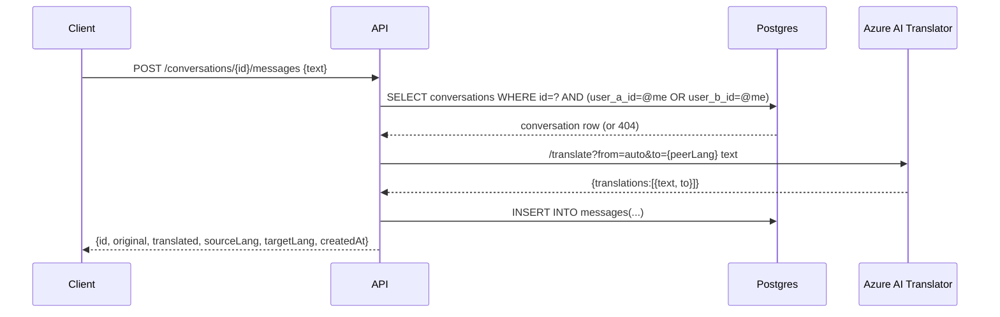
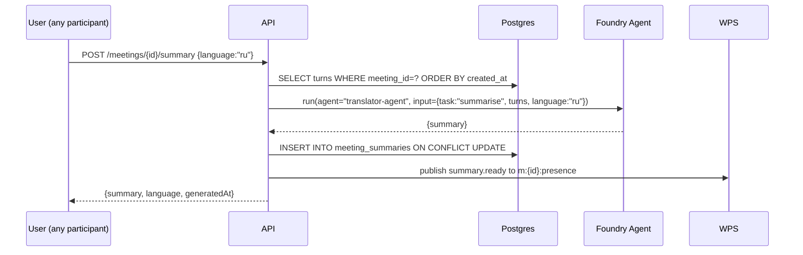

# AI Translator — Design

Status: **DRAFT for review**
Owner: Sergey
Last updated: 2026-07-16

Companion documents:
- `README.md` — original Foundry-basic deployment guide (still valid for the Foundry + App Service base stack).
- `../infra-as-code/bicep/` — already-deployed Bicep modules (Foundry, Translator, Speech, Postgres, Web PubSub, Key Vault, App Service).

This document specifies **only the workload-specific contract**: database schema, REST API, Web PubSub protocol, join-token structure, and the end-to-end flows. Infra decisions are documented inline in each `*.bicep` module.

---

## 1. Recap of architectural decisions

| Concern | Decision |
|---|---|
| Auth | Entra ID (workforce) via App Service Easy Auth v2 for MVP; Entra External ID added later as a second identity provider. Test users = real Entra ID guests. |
| Data store | PostgreSQL Flexible Server 16 with `pgvector`. Entra-only auth (no passwords). |
| Real-time | Azure Web PubSub, WebSocket fan-out per language group. |
| Personal-chat translation | Azure AI Translator (text). |
| Meeting translation | Azure AI Speech Translation on the client (STT + MT multi-target). Neural TTS on the client. |
| Reasoning tasks | Foundry Agent (GPT-4.1) for addressee-hint and meeting summarization only. |
| Audio | Never persisted. |
| Meeting join | Initiator gets QR + shareable URL. Join enforces sign-in and preferred-language selection. |
| Data isolation | Enforced in repositories by `userId` (from Easy Auth) and `meetingId ∈ my participation`. No Postgres RLS in MVP. |

---

## 2. Postgres schema

Database: `translator` (created by `postgres.bicep`).
Extensions required: `pgvector` (allow-listed at server; `CREATE EXTENSION vector;` runs in the migration).
All timestamps are `timestamptz` in UTC.

```sql
-- People signed into the workload via Easy Auth.
CREATE TABLE users (
    id                 uuid        PRIMARY KEY DEFAULT gen_random_uuid(),
    entra_object_id    text        NOT NULL UNIQUE,
    display_name       text        NOT NULL,
    email              text        NOT NULL,
    preferred_language text        NOT NULL DEFAULT 'en',
    created_at         timestamptz NOT NULL DEFAULT now(),
    updated_at         timestamptz NOT NULL DEFAULT now()
);

-- Personal-chat conversations. Canonicalised so (A,B) == (B,A).
CREATE TABLE conversations (
    id           uuid        PRIMARY KEY DEFAULT gen_random_uuid(),
    user_a_id    uuid        NOT NULL REFERENCES users(id),
    user_b_id    uuid        NOT NULL REFERENCES users(id),
    created_at   timestamptz NOT NULL DEFAULT now(),
    CHECK (user_a_id < user_b_id),           -- canonicalise ordering
    UNIQUE (user_a_id, user_b_id)
);
CREATE INDEX idx_conv_user_a ON conversations(user_a_id);
CREATE INDEX idx_conv_user_b ON conversations(user_b_id);

-- Personal-chat messages. Optional embedding for future semantic search.
CREATE TABLE messages (
    id              uuid        PRIMARY KEY DEFAULT gen_random_uuid(),
    conversation_id uuid        NOT NULL REFERENCES conversations(id) ON DELETE CASCADE,
    from_user_id    uuid        NOT NULL REFERENCES users(id),
    source_lang     text        NOT NULL,
    target_lang     text        NOT NULL,
    original        text        NOT NULL,
    translated      text        NOT NULL,
    embedding       vector(1536),
    created_at      timestamptz NOT NULL DEFAULT now()
);
CREATE INDEX idx_messages_conv_time ON messages(conversation_id, created_at DESC);
CREATE INDEX idx_messages_embedding ON messages USING ivfflat (embedding vector_cosine_ops) WITH (lists = 100);

-- On-site meetings created by an initiator.
CREATE TABLE meetings (
    id           uuid        PRIMARY KEY DEFAULT gen_random_uuid(),
    initiator_id uuid        NOT NULL REFERENCES users(id),
    title        text,
    status       text        NOT NULL DEFAULT 'active' CHECK (status IN ('active','ended')),
    created_at   timestamptz NOT NULL DEFAULT now(),
    ended_at     timestamptz
);
CREATE INDEX idx_meetings_initiator ON meetings(initiator_id, created_at DESC);

-- Meeting participants. Language chosen at join time; users can change and it
-- switches the WPS subscription (see §4).
CREATE TABLE participants (
    id         uuid        PRIMARY KEY DEFAULT gen_random_uuid(),
    meeting_id uuid        NOT NULL REFERENCES meetings(id) ON DELETE CASCADE,
    user_id    uuid        NOT NULL REFERENCES users(id),
    language   text        NOT NULL,
    role       text        NOT NULL CHECK (role IN ('initiator','listener')),
    joined_at  timestamptz NOT NULL DEFAULT now(),
    left_at    timestamptz,
    UNIQUE (meeting_id, user_id)
);
CREATE INDEX idx_participants_user ON participants(user_id, joined_at DESC);

-- One row per spoken utterance. Original is stored in speaker's language.
CREATE TABLE turns (
    id           uuid        PRIMARY KEY DEFAULT gen_random_uuid(),
    meeting_id   uuid        NOT NULL REFERENCES meetings(id) ON DELETE CASCADE,
    speaker_id   uuid        NOT NULL REFERENCES users(id),
    addressee_id uuid        REFERENCES users(id),          -- optional, from Foundry hint
    source_lang  text        NOT NULL,
    original     text        NOT NULL,
    embedding    vector(1536),
    created_at   timestamptz NOT NULL DEFAULT now()
);
CREATE INDEX idx_turns_meeting_time ON turns(meeting_id, created_at DESC);

-- Materialised translations per listener language, so participants can
-- re-read history in their chosen language after the fact.
CREATE TABLE turn_translations (
    turn_id     uuid REFERENCES turns(id) ON DELETE CASCADE,
    target_lang text NOT NULL,
    translated  text NOT NULL,
    PRIMARY KEY (turn_id, target_lang)
);

-- Meeting summary produced by the Foundry agent, cached per language.
CREATE TABLE meeting_summaries (
    meeting_id   uuid        NOT NULL REFERENCES meetings(id) ON DELETE CASCADE,
    language     text        NOT NULL,
    summary      text        NOT NULL,
    generated_at timestamptz NOT NULL DEFAULT now(),
    PRIMARY KEY (meeting_id, language)
);
```

Notes:
- **No Postgres row-level security in MVP.** Every repository method takes the caller's `userId` and filters explicitly. This keeps EF Core migrations simple. RLS can be added later without breaking the API surface.
- **Join tokens are not persisted.** They are stateless JWTs (see §5) signed with a Key Vault-hosted HMAC key. Revocation is achieved by marking `meetings.status = 'ended'` — the join handler rejects tokens for ended meetings.
- **Embeddings** are optional today; back-fill later. Kept nullable so we don't block the write path.

---

## 3. REST API

Base: `/api`. All endpoints require Easy Auth (Entra ID). Responses are JSON. Errors use RFC 7807 `application/problem+json`.

### 3.1 Me

| Method | Path | Body | Returns |
|---|---|---|---|
| GET | `/api/me` | — | `{id, displayName, email, preferredLanguage}` — auto-created on first call from Easy Auth `X-MS-CLIENT-PRINCIPAL` claims |
| PATCH | `/api/me` | `{preferredLanguage}` | updated me |
| GET | `/api/users?query=` | — | `[{id, displayName, email, preferredLanguage}]` — matches Entra people via Microsoft Graph; only tenant users |

### 3.2 Personal chat

| Method | Path | Body | Returns |
|---|---|---|---|
| GET | `/api/conversations` | — | `[{id, peer, lastMessageAt}]` — only conversations I participate in |
| POST | `/api/conversations` | `{peerId}` | `{id, peer}` — idempotent (finds existing) |
| GET | `/api/conversations/{id}/messages?before=<iso>&limit=50` | — | paged messages — 404 if I'm not a participant |
| POST | `/api/conversations/{id}/messages` | `{text, targetLanguage?}` | `{id, original, translated, sourceLang, targetLang, createdAt}` — `sourceLang` autodetected via Translator |

### 3.3 Meetings

| Method | Path | Body | Returns |
|---|---|---|---|
| GET | `/api/meetings/mine` | — | `[{id, title, status, role, createdAt}]` — meetings where I'm initiator or participant |
| POST | `/api/meetings` | `{title?}` | `{meetingId, joinToken, joinUrl, qrPngDataUrl}` — initiator only, called by the "Start on-site meeting" button |
| GET | `/api/meetings/{id}` | — | `{id, title, status, initiator, participants:[{userId,name,language,role}]}` — must be participant |
| POST | `/api/meetings/{id}/end` | — | 204 — initiator only, marks `status='ended'` and publishes `meeting.ended` on presence group |
| POST | `/api/meetings/join?token=<jwt>` | `{language}` | `{meetingId, participants, wps:{url, expiresAt}}` — validates JWT, upserts participant, returns WPS client access URL scoped to this user's groups |
| POST | `/api/meetings/{id}/leave` | — | 204 — sets `left_at`, publishes `presence.left` |
| GET | `/api/meetings/{id}/turns?before=<iso>&limit=100&lang=<code>` | — | paged turns, translations in `lang` (default = my preferred) — participant only |
| POST | `/api/meetings/{id}/turns` | `{original, sourceLang, translations:{lang:text,…}, addresseeId?}` | `{turnId, createdAt}` — persist and fan out. Speaker-only (verified via Easy Auth = participant with `role != 'listener'` or Entra id = speaker) |
| POST | `/api/meetings/{id}/summary` | `{language?}` | `{summary, language, generatedAt}` — calls Foundry agent, caches per language |
| GET | `/api/meetings/{id}/summary?lang=<code>` | — | cached summary if any |

### 3.4 Speech

| Method | Path | Body | Returns |
|---|---|---|---|
| GET | `/api/speech/token` | — | `{token, region, expiresAt}` — 10-minute Entra bearer scoped to `https://cognitiveservices.azure.com`, region = Speech account region. Consumed by the browser Speech SDK. |

### 3.5 Foundry addressee hint (optional UX)

| Method | Path | Body | Returns |
|---|---|---|---|
| POST | `/api/meetings/{id}/addressee-hint` | `{recentTurnIds}` | `{addresseeId, confidence, rationale}` — Foundry agent inspects recent turns + participant list and returns the most likely addressee. Used to emphasise a listener in the UI; not used for delivery. |

---

## 4. Web PubSub protocol

Hub name: `meetings` (fixed in `web-app.bicep` appsettings).

### 4.1 Groups

Each meeting uses three group families. Clients receive an access URL from `POST /meetings/join` that pre-authorises exactly the groups they need.

| Group | Purpose | Members |
|---|---|---|
| `m:{meetingId}:presence` | join/leave events, participant list changes, `meeting.ended` | all participants |
| `m:{meetingId}:lang:{langCode}` | translated turns in one language | participants who chose that language |
| `m:{meetingId}:u:{userId}` | targeted private events (e.g. "you were addressed") | that specific user |

When a participant changes their language on the client, the client calls `POST /meetings/{id}/join` again with the new `language`, receives a fresh access URL, and re-subscribes.

### 4.2 Server → client message envelopes

All messages are JSON. `type` is the only required discriminator. `ts` is ISO-8601 UTC.

```jsonc
// Translated turn — sent once per (turn, targetLanguage) to the corresponding lang group.
{
  "type": "turn.translated",
  "meetingId": "…",
  "turnId": "…",
  "speaker": { "id": "…", "displayName": "…" },
  "sourceLang": "en",
  "targetLang": "ru",
  "original": "Can you confirm the delivery date?",
  "translated": "Вы можете подтвердить дату доставки?",
  "addresseeId": null,
  "ts": "2026-07-16T12:34:56Z"
}

// Participant joined or updated their language.
{ "type": "presence.joined", "meetingId": "…", "participant": { "id":"…","displayName":"…","language":"ru" }, "ts": "…" }
{ "type": "presence.left",   "meetingId": "…", "participantId": "…", "ts": "…" }

// Meeting ended by initiator.
{ "type": "meeting.ended", "meetingId": "…", "ts": "…" }

// Optional: private "you were the addressee of the last turn"
{ "type": "u.addressed", "meetingId": "…", "turnId": "…", "ts": "…" }

// Summary ready (after POST /summary completes).
{ "type": "summary.ready", "meetingId": "…", "language": "ru", "ts": "…" }
```

Clients ignore unknown `type` values. New types can be added freely.

### 4.3 Backend publishing sequence

On `POST /meetings/{id}/turns`:
1. Persist `turns` row.
2. For each `(target_lang, translated)` in the body, insert `turn_translations` row.
3. For each participant language present in the meeting, publish one `turn.translated` message to `m:{id}:lang:{lang}`.
4. If `addresseeId` set, publish `u.addressed` to `m:{id}:u:{addresseeId}`.

All four steps are best-effort; failure of the WPS publish is logged but doesn't fail the HTTP call (turn is already persisted and can be replayed via `GET /turns`).

---

## 5. Meeting join token

Format: JWT, HS256, signed with the secret stored in Key Vault under name `join-token-signing-key` (see `main.bicep` post-deploy hint).

Claims:

| Claim | Type | Value |
|---|---|---|
| `iss` | string | `https://<appService>/` |
| `aud` | string | `meeting-join` |
| `sub` | string | `meeting:{meetingId}` |
| `mid` | string | `{meetingId}` (redundant convenience) |
| `iat` | number | issue time (unix seconds) |
| `exp` | number | expiry — `iat + 24h` |
| `jti` | string | random UUID for future revocation lists |

The join URL is `https://<app>/join/{jwt}` — the front-end route reads the path segment, POSTs it to `/api/meetings/join?token=…`. QR code is a PNG of that URL.

Validation on `POST /meetings/join`:
1. Fetch signing key from Key Vault (cached in-memory for 5 min).
2. Verify HS256 signature + `iss`, `aud`, `exp`.
3. Load `meetings.status`. If `ended`, respond 410 Gone.
4. Upsert `participants(meeting_id=mid, user_id=me, language=body.language, role='listener')`.
5. Issue Web PubSub client access URL with `roles = ['webpubsub.joinLeaveGroup.m:{mid}:presence','webpubsub.joinLeaveGroup.m:{mid}:lang:{language}','webpubsub.joinLeaveGroup.m:{mid}:u:{myUserId}']`.

---

## 6. End-to-end flows

### 6.1 Personal chat send



### 6.2 Meeting create + join by QR

```mermaid
sequenceDiagram
  participant I as Initiator
  participant A as API
  participant KV as Key Vault
  participant PG as Postgres
  participant G as Guest
  participant EA as Easy Auth
  participant WPS as Web PubSub

  I->>A: POST /meetings {title}
  A->>PG: INSERT meetings, INSERT participants(role=initiator)
  A->>KV: GET secret join-token-signing-key (cached)
  A->>A: sign JWT (mid, exp=24h)
  A-->>I: {meetingId, joinToken, joinUrl, qrPngDataUrl}

  Note over I,G: Guest scans QR
  G->>A: GET /join/{token}
  A->>EA: redirect to /.auth/login/aad
  EA-->>G: signed in, redirect back
  G->>A: POST /meetings/join?token=… {language:"ru"}
  A->>KV: GET signing key
  A->>A: verify JWT, extract mid
  A->>PG: check meetings.status='active'; upsert participants
  A->>WPS: generateClientAccessUrl(user=me, groups=[presence,lang:ru,u:me])
  A-->>G: {meetingId, participants, wps:{url,expiresAt}}
  G->>WPS: WebSocket connect
  A->>WPS: publish presence.joined to m:{id}:presence
```

### 6.3 Meeting turn (speaker → all listeners)

```mermaid
sequenceDiagram
  participant S as Speaker (browser)
  participant A as API
  participant SP as Azure Speech
  participant PG as Postgres
  participant WPS as Web PubSub
  participant L as Listener (browser)

  S->>A: GET /speech/token
  A->>SP: (Entra token exchange — scope=cognitiveservices)
  A-->>S: {token, region, expiresAt}

  S->>SP: startContinuousRecognitionAsync(targetLangs=[ru,fr,de,…])
  SP-->>S: recognized {original:"...", translations:{ru:"...", fr:"...", de:"..."}}
  S->>A: POST /meetings/{id}/turns {original, sourceLang:"en", translations, addresseeId?}
  A->>PG: INSERT turns; INSERT turn_translations rows
  loop for each participant language
    A->>WPS: publish turn.translated to m:{id}:lang:{lang}
  end
  WPS-->>L: turn.translated {translated:"..."}
  L->>SP: SpeechSynthesizer.speakTextAsync(translated, lang)
```

Notes:
- The speaker's browser performs STT + MT via Speech Translation directly. Backend never sees audio.
- Backend re-broadcasts the finalized text. It doesn't re-translate.
- The listener performs TTS locally (Speech SDK or Web Speech). Backend never sends audio bytes over WPS.

### 6.4 Meeting summary



---

## 7. Backend project layout (planned)

```
website/chatui/
├─ Program.cs
├─ appsettings.json
├─ Configuration/
│  ├─ AppOptions.cs            (typed options: Translator, Speech, WPS, Postgres, KeyVault, AI agent)
│  └─ FoundryAgentResolver.cs  (unchanged)
├─ Auth/
│  ├─ IUserContext.cs          (current userId + display + language, from Easy Auth principal)
│  └─ EasyAuthUserContext.cs
├─ Data/
│  ├─ TranslatorDbContext.cs   (EF Core, Npgsql)
│  ├─ Entities/                (User, Conversation, Message, Meeting, Participant, Turn, TurnTranslation, MeetingSummary)
│  ├─ Repositories/            (scoped queries — every method takes userId)
│  └─ Migrations/
├─ Services/
│  ├─ TranslatorService.cs     (Azure AI Translator SDK, Entra token via DefaultAzureCredential)
│  ├─ SpeechTokenService.cs    (mints short-lived Entra tokens for Speech)
│  ├─ FoundryAgentService.cs   (addressee hint + summary via Microsoft.Agents.AI.Foundry)
│  ├─ WebPubSubBroadcaster.cs  (publish to groups; generateClientAccessUrl per user)
│  └─ JoinTokenService.cs      (KV-backed HMAC JWT issue/verify with in-memory key cache)
├─ Controllers/
│  ├─ MeController.cs
│  ├─ UsersController.cs
│  ├─ ConversationsController.cs
│  ├─ MessagesController.cs
│  ├─ MeetingsController.cs
│  ├─ SpeechController.cs
│  └─ ChatController.cs        (legacy — kept for the Foundry-basic demo; secured with owner check TODO)
└─ Views/…                     (initial minimal MVC UI; replaced by SPA in the frontend-app todo)
```

New NuGet packages required (added to `chatui.csproj` in the backend task):

- `Microsoft.EntityFrameworkCore` (10.0.x preview)
- `Npgsql.EntityFrameworkCore.PostgreSQL` (10.x for .NET 10)
- `Azure.Identity` (already transitively present)
- `Azure.AI.Translation.Text`
- `Azure.Messaging.WebPubSub`
- `Azure.Security.KeyVault.Secrets`
- `Microsoft.IdentityModel.JsonWebTokens`
- `QRCoder` (or generate QR on the client via `qrcode` npm package to avoid a native dep)

---

## 8. Non-goals for MVP

The following are out of scope for the first cut but explicitly designed-around so we don't paint ourselves into a corner:

- Postgres RLS. Repository-level enforcement is simpler; RLS can layer on top later.
- Meeting audio recording. Never persisted today; can be added by streaming to Blob under an explicit consent toggle (Phase 6).
- Private endpoints and VNet integration (Phase 6).
- CI/CD in Azure DevOps `ContosoMortgage123` (Phase 5).
- External guest users via Entra External ID (Phase 6 second identity provider).
- Web PubSub client → server messages. Clients never publish to WPS directly; they always go through the REST API. This keeps authorization simple.

---

## 9. Confirmed design decisions

_Answered on 2026-07-16:_

1. **.NET version**: **.NET 10 LTS** (already GA since November 2025, supported until November 2028). `chatui.csproj` stays on `net10.0`. EF Core 10 and Npgsql 10 are GA on this stack.
2. **QR generation**: **Both**. Backend returns `joinUrl` **and** `qrPngDataUrl` (server-side PNG via QRCoder, ~2 KB) so the UI can render immediately without a second round-trip and email/print work without JavaScript. Client can also draw its own hi-DPI QR from `joinUrl` if it wants.
3. **Legacy `ChatController` and `Views/Home/Index.cshtml`**: **Deleted**. They were leftovers from the Foundry-basic template. `FoundryAgentResolver` stays — reused by the new `FoundryAgentService` for addressee-hint and summary. Bing grounding stays on the agent side.
4. **Speech access from the browser**: **Only Entra token via `/api/speech/token`**. Speech account already has `disableLocalAuth: true` in `speech.bicep`; no keys exist anywhere. Backend mints a bearer token scoped to `https://cognitiveservices.azure.com`, TTL ≈ 10 minutes, browser passes it to the Speech SDK.
5. **`meetings.title`**: **Optional**. Backend fills a fallback like `"On-site meeting — 2026-07-16"` when omitted.
